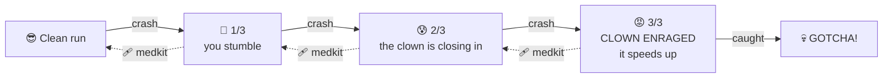

<div align="center">

# 🩺⛷️ DR. DOWNHILL 🤡

### *The clowns are coming. Ski for your life.*

**[▶ PLAY NOW: dr-downhill.netlify.app](https://dr-downhill.netlify.app/)**

[](https://dr-downhill.netlify.app/)


</div>

---

You're a doctor. You're on skis. The mountain never ends.

A clown is chasing you down it. Sometimes it's on foot, sometimes it's on skis, and the more you crash, **the angrier it gets.**

Dr. Downhill is a 3D endless downhill survival game that runs in your browser. Weave through trees, launch off ramps over crevasses, grab supplies, and see how long you last before you hear the honk right behind you.

> 🔊 Turn your sound on. You'll hear the clown before you see it.

---

## 🎮 Controls

| Action | Keyboard | Touch |
| --- | --- | --- |
| Steer | <kbd>←</kbd> <kbd>→</kbd> or <kbd>A</kbd> <kbd>D</kbd> | ◀ ▶ |
| Jump | <kbd>Space</kbd> / <kbd>↑</kbd> / <kbd>W</kbd> | **JUMP** |
| Tuck (go faster) | <kbd>↓</kbd> / <kbd>S</kbd> | ▼ |
| Look back (if you dare) | <kbd>C</kbd> / <kbd>Shift</kbd> | 👀 |
| Pause | <kbd>Esc</kbd> / <kbd>P</kbd> | ❚❚ |
| Mute | <kbd>M</kbd> | 🔊 |

Works on phones too. On-screen buttons show up automatically on touch devices.

---

## 🤡 The Three Strikes Rule

Hitting a tree, rock, snowman or log counts as a **crash**. Every crash lets the clown close the gap.



Grab a **medkit** to patch up one crash. If the clown is enraged, it calms back down.

---

## 💉 Pickups

| | Pickup | What it does |
| :-: | --- | --- |
| ✚ | **Coin** | +25 points. Ramps fling you through arcs of them. |
| 🩹 | **Medkit** | Removes one crash. With zero crashes you get **+100** for a clean bill of health. |
| 💉 | **Adrenaline** | 5 seconds of speed boost. You **smash through obstacles** and go **clown bowling**. |

---

## 🏔️ What's on the mountain

- 🌲 **Trees, rocks, snowmen & logs:** classic crash material
- ❄️ **Snow drifts:** they only slow you down (*POOF!*), no crash
- 🛷 **Ramps over crevasses:** hit them clean for **AIR TIME** bonus points. Miss and you're falling into a gap.
- 🚶 **Clown crossings:** wandering clowns stroll across the slope. Ski into one and it counts as a crash.
- ⛷️ **Skiing clowns:** they're on the slope too, and they get in your way
- 🎯 **Tripping clowns:** lead the chaser into an obstacle for **CLOWN DOWN! +50**

---

## 🏆 Scoring

| Move | Points |
| --- | --- |
| Distance | keeps climbing the farther you get |
| Coin | +25 |
| Big air | **AIR TIME +bonus** |
| Smash an obstacle while boosted | +20 |
| Clown bowling (boosted) | +30 |
| Make the clown trip | +50 |
| Medkit with no crashes | +100 |

Your best score is saved locally. Have fun beating it.

---

## 🛠️ Run it locally

```bash
git clone https://github.com/ethanbrook-dev/dr-downhill.git
cd dr-downhill
npm install
npm run dev        # start the dev server
```

| Script | What it does |
| --- | --- |
| `npm run dev` | Vite dev server with hot reload |
| `npm run dev:host` | Same, but exposed on your LAN so you can test on your phone |
| `npm run build` | Type-check + production build into `dist/` |
| `npm run preview` | Serve the production build |
| `npm run typecheck` | Just the TypeScript check |

---

## 🧠 Under the hood

No game engine and no art assets. Everything is built in code with **Three.js** and **TypeScript**.

```
src/
├── Game.ts              🎬 the main loop, scoring, crash ladder
├── audio/Sfx.ts         🔊 procedural sound: honks, laughs, crashes, music
├── core/                🎥 camera rig, input, math, local storage
├── entities/            🩺 the doctor, 🤡 the clowns, and the director that runs them
├── fx/Particles.ts      ✨ snow sprays, coin bursts, rage steam
├── ui/Hud.ts            📟 HUD, clown-distance meter, menus
└── world/               🏔️ noise-based terrain, chunk streaming, props
```

- **Infinite mountain:** terrain is generated from noise and streamed in chunks as you ski
- **Toon-shaded models:** the doctor and the clowns are built from primitives in code
- **Procedural audio:** every sound effect is synthesized at runtime, no audio files

---

<div align="center">

### Think you can outrun it?

**[🩺 dr-downhill.netlify.app 🤡](https://dr-downhill.netlify.app/)**

<sub>MIT licensed · made by Ethan Brook · no clowns were harmed (okay, a few were)</sub>

</div>
